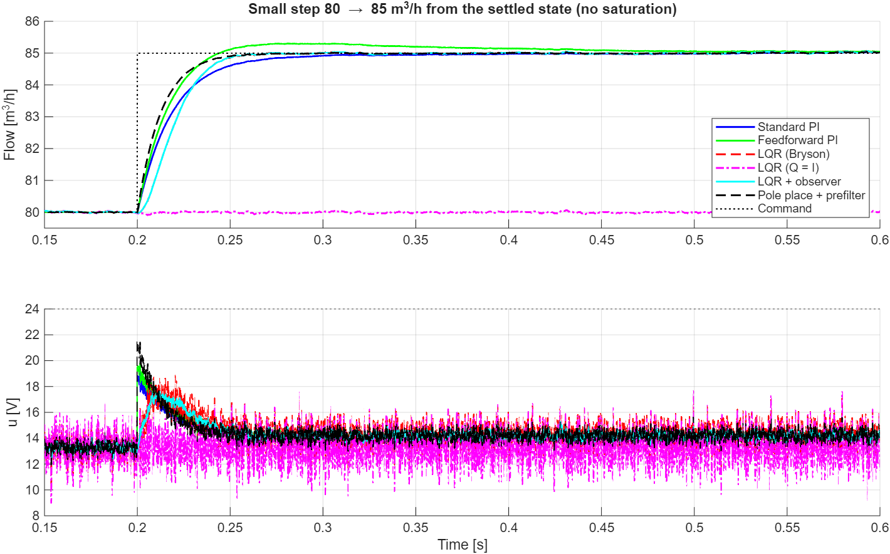
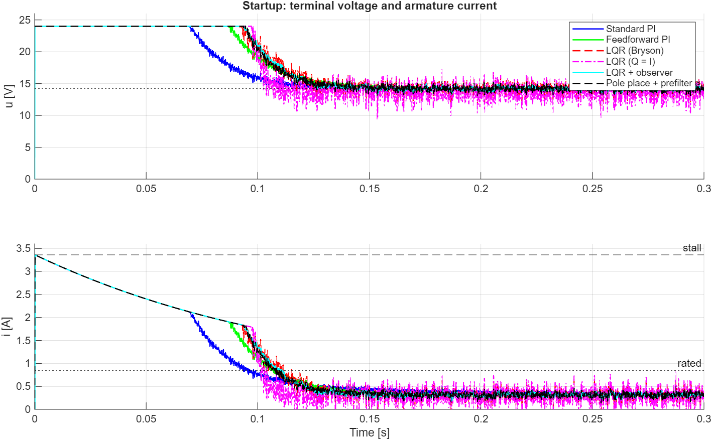
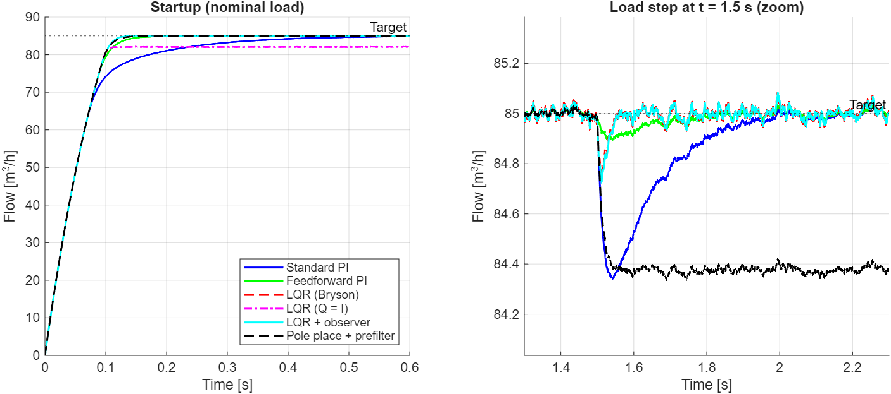
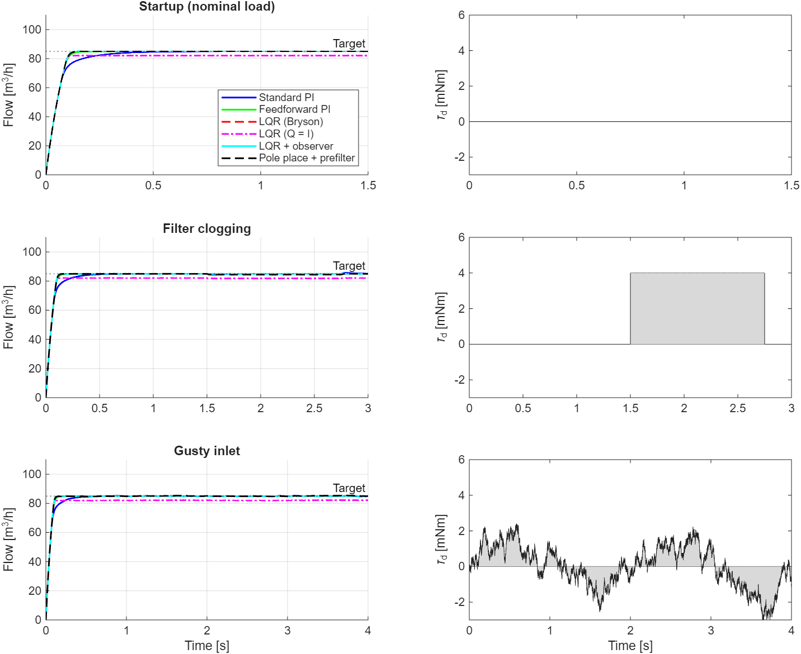
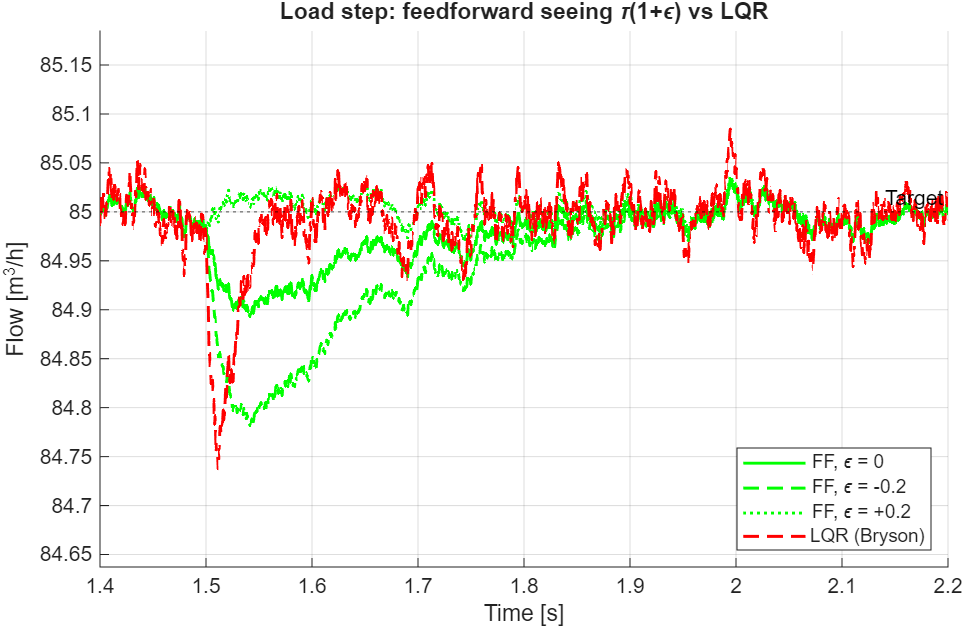
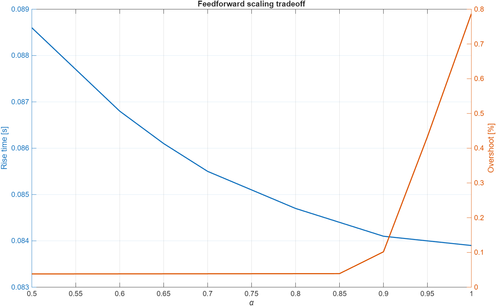

# Duct-fan flow control: PI vs feedforward PI vs LQR

Controller comparison for a small ventilation duct fan driven by a brushed DC
micromotor, regulating speed-referenced airflow to 85 m³/h at a 4000 rpm
operating point. Six designs share one plant, one sample rate, one sensor
noise level, and one set of scenarios: a standard PI, the same PI with
inverse-dynamics feedforward, an LQR with an augmented integral state
weighted by Bryson's rule, the same LQR running from a single sensor through
a Luenberger observer, and two deliberate strawmen — the LQR with naive
`Q = eye(3)` weighting, and pole placement with a static prefilter and no
integral state. The study measures a small setpoint step (the linear
comparison), startup from rest (a saturation study), rejection of a
load-torque step (filter clogging), and tracking under a continuously
varying load (gusty inlet).

**What is actually being controlled.** Flow here is inferred from shaft
speed by the fan affinity law (Q ∝ ω) at the nominal duct restriction. The
feedback signal is therefore a speed measurement with a constant on it, and
every controller in this study is a speed servo whose output is reported in
m³/h. A change in duct restriction — the thing "filter clogging" physically
is — would change the flow at a given speed, and *none* of these controllers
can see that; it enters this model only as the shaft-torque change that
accompanies it. The title is kept because the application is flow; the
honest description of the control problem is speed regulation under load
disturbances. Extending the plant with a fan curve and duct resistance so
that a real flow measurement can be closed on is the obvious next step, and
is not done here because it would require inventing a P–Q characteristic.

Three methodological points carry the comparison:

1. **An LQR is a regulator; a tracking problem has to be posed in deviation
   coordinates.** Designed on absolute states, the speed feedback demands
   `w → 0` with hundreds of volts and the integrator spends its whole
   budget cancelling that. Posed as deviations from the operating point,
   the integrator holds only the 14 V operating voltage, and the Bryson
   maxima mean what they say.
2. **A setpoint step that hits the actuator rail is not a controller
   comparison.** On startup every good design sits at 24 V and stall
   current for 70–100 ms with the loop effectively open, and the "rise
   times" differ only in how each leaves the rail. The small-signal step
   is where the linear designs are compared.
3. **Sensor noise is where an observer earns its keep.** Full-state feedback
   reads two noisy sensors straight into the gain matrix; the observer
   reads one and filters it. With noise in the loop, the single-sensor
   LQR is the quietest design in the set.

## Hardware

**Motor — FAULHABER 2342 S 024 CR** (24 V, graphite commutation), all values
from the series 2342…CR datasheet, edition 2026-03-23:

| Parameter | Datasheet | SI value used |
|---|---|---|
| Terminal resistance R | 7.14 Ω | 7.14 Ω |
| Rotor inductance L | 264 µH | 2.64e-4 H |
| Torque constant Kt | 28.6 mNm/A | 0.0286 N·m/A |
| Speed constant kn | 334 rpm/V | Ke = 0.02859 V·s/rad |
| Rotor inertia | 5.8 g·cm² | 5.8e-7 kg·m² |
| Rated torque / current / speed | 20.5 mNm / 0.846 A / 5660 rpm | — |
| Friction torque | 0.99 mNm | Coulomb |

Consistency check: in SI units Kt and Ke are the same physical constant;
here they agree to 0.03%, which validates the unit conversions.

**Load — 80 mm axial impeller, direct drive.** These are *estimates*, not
datasheet figures:

- Impeller inertia from mass and radius (20 g, 40 mm tip radius) using a
  solid-disc approximation J = ½mr². Conservative, since a real impeller
  carries much of its mass near the hub. Total J is 28× the rotor inertia.
- Aerodynamic load follows the fan law, τ = k_a·ω², pinned to 8 mNm at the
  operating point (~3.4 W shaft power, plausible for an 80 mm fan at
  4000 rpm). The datasheet friction torque is modelled as Coulomb.
- Airflow inferred from shaft speed by the fan affinity law, calibrated at
  the nominal duct restriction: 85 m³/h at 4000 rpm.

Operating point vs ratings: 9.0 mNm, 0.314 A, 14.2 V — inside the 20.5 mNm
/ 0.846 A / 24 V continuous ratings with headroom for disturbances.

## Model

**Simulated plant (the truth):** states x = [current; shaft speed], input
u = terminal voltage saturated to [0, 24] V, load torque k_a·ω² + Coulomb
friction + disturbance τ_d. Integrated with RK4 at 20 µs substeps, input held
over each controller period. Halving the substep twice moves the reported
startup rise time by less than 0.01%.

**Design model (what the controllers know):** the tangent linearisation
about the operating point, in deviation coordinates δx = x − x_op,
δu = u − V_ss, δy = y − Q_op. The small-signal aero damping is the *slope*
of k_a·ω² at the operating point, 2·k_a·ω_op — the secant τ/ω that a
viscous-drag model would use is 44% low. Coulomb friction contributes no
slope. Open-loop poles −27039 rad/s (electrical) and −9.2 rad/s
(mechanical). (A, B) controllable, (A, C) observable.

**Implementation:** every controller runs as a discrete-time law at
Ts = 100 µs (10 kHz). The LQR, observer, and pole-placement gains are
designed on the zero-order-hold discretisation at Ts (`c2d`, `dlqr`,
discrete `place`), not on the continuous model — the electrical pole is far
above any sensible sample rate and a continuous design would not transfer.
The PI uses a forward-Euler integrator at Ts.

**Sensor noise:** white at Ts, 0.25 m³/h (1-σ, 0.3% of setpoint) on the flow
measurement and 10 mA on the current measurement. All controllers see the
same noise sequence in a given scenario; all metrics are computed on the
true, noise-free flow. The *actuator* jitter each design produces in
steady state is reported as `u-std`.

**Anti-windup:** conditional integration on every design with an
integrator — the integrator is frozen while the input is saturated and the
error would drive it further in. A consequence worth knowing before reading
the startup table: the integrator is left at zero when the rail releases.

## Controllers

- **Standard PI** on flow error, Kp = 3928 V/(m³/s), Ki = 32076 V/m³ —
  derived, not tuned. The electrical pole is ~3000× faster than the
  mechanical one, so di/dt → 0 reduces the plant to first order
  (τ = 0.109 s, k_dc = 1.48e-3 m³/s per V, with the back-EMF damping
  Kt·Ke/R folded into the effective friction), and PI on a first-order
  plant gives an exactly second-order closed loop: ζ = 1.5, ωn = 20.9 rad/s
  (a deliberately overdamped baseline) determine both gains. The closed-loop
  poles are −54.7 and −7.98; the PI zero at −8.17 nearly cancels the slow
  one, so the linear response is effectively first order with a 40 ms rise.
  Loop margins as implemented: GM 56 dB, PM 91°, crossover 53 rad/s.
- **Feedforward PI**: adds α·V_ff, with V_ff the inverse dynamics at the
  *commanded* flow (nominal k_a·ω² + friction, plus a *measured* load
  torque). α = 0.86 from the sweep below. Because V_ff steps with the
  command, it is the fastest to react to a setpoint change and the only
  design that overshoots it meaningfully.
- **LQR + integral (Bryson)**: deviation state augmented with
  ξ = Σ Ts·(Q_cmd − y). Bryson maxima: 3 A current excursion, 40 rad/s
  speed error, 2.8e-5 m³/s·s integrated error (≈1 m³/h for 0.1 s), 24 V
  input. K = [0.304 V/A, 0.639 V/(rad/s), −5.88e5 V/(m³/s·s)]. Closed-loop
  poles (s-equivalent) −34436 and a well-damped pair −78.9 ± 39.3j
  (ζ ≈ 0.89). At the operating point the integrator holds ξ = 2.42e-5 —
  inside the 2.8e-5 it was budgeted for. Loop margins at the plant input:
  GM 28 dB, PM 77°, crossover 160 rad/s. Reads both sensors.
- **LQR + integral (Q = I)**: identical architecture with the naive
  `Q = eye(3), R = 1` weighting. Closed-loop poles −27207, −240,
  **−5.6e-5** — the integral state is effectively unweighted. Kept to show
  what that costs.
- **LQR + observer**: the Bryson LQR running on the flow measurement alone,
  with a discrete Luenberger observer reconstructing the current. The
  observer leaves the electrical mode where the plant puts it (−27039) and
  places the mechanical-estimate pole at −2000; L = [−12.8, 3200]. It is
  driven by the *delivered* (saturated) input and is given no knowledge of
  the load disturbance.
- **Pole placement + prefilter**: discrete state feedback at the LQR's own
  pole real parts (−34436, −78.9), u = V_ss − K·δx + G·(Q_cmd − Q_op) with
  G inverting the nominal DC gain. No integral state. Reads both sensors.

## Results

All numbers from `results.txt`. Rise = 10–90%; settle = last time outside
the band; dip and recovery are for the +4 mNm filter-clogging step, to a
±0.5% band (the dips sit inside the 2% settling band, which would read zero
for everyone); `u-std` is the actuator jitter in steady state.

### Small step, 80 → 85 m³/h from the settled state — the linear comparison

Overshoot and the 5% settling band are relative to the 5 m³/h step. Nothing
touches the rail (peak u ≤ 21.5 V).

| Controller | Rise [s] | OS [% step] | Settle [s] | u-std [V] |
|---|---|---|---|---|
| Standard PI | 0.043 | 0.7 | 0.061 | 0.27 |
| Feedforward PI | 0.029 | 6.1 | 0.123 | 0.27 |
| LQR (Bryson) | 0.032 | 1.4 | 0.045 | 0.77 |
| LQR (Q = I) | never | n/a | >0.8 | 1.15 |
| LQR + observer | 0.032 | 1.3 | 0.045 | **0.25** |
| Pole place + prefilter | **0.028** | 0.8 | **0.038** | 0.36 |



### Startup from rest — a saturation study

| Controller | Rise [s] | Settle [s] | SS [m³/h] | Peak i [A] | On the rail until [s] |
|---|---|---|---|---|---|
| Standard PI | 0.109 | 0.305 | 85.00 | 3.36 | 0.070 |
| Feedforward PI | 0.084 | 0.123 | 85.00 | 3.36 | 0.088 |
| LQR (Bryson) | 0.084 | 0.111 | 85.00 | 3.36 | 0.093 |
| LQR (Q = I) | 0.084 | >1.5 | **82.06** | 3.36 | 0.098 |
| LQR + observer | 0.084 | 0.110 | 85.00 | 3.36 | 0.094 |
| Pole place + prefilter | 0.084 | 0.112 | 85.00 | 3.36 | 0.095 |



### Filter clogging (+4 mNm at t = 1.5 s, held to 2.75 s)

SS is measured *while the load is on* (t ∈ [2.25, 2.75] s).

| Controller | Dip [%] | Recover [s] | SS under load [m³/h] |
|---|---|---|---|
| Standard PI | 0.76 | 0.113 | 85.00 |
| Feedforward PI | **0.11** | 0 | 85.01 |
| LQR (Bryson) | 0.28 | 0 | 85.00 |
| LQR (Q = I) | — | — | 81.85 |
| LQR + observer | 0.29 | 0 | 85.00 |
| Pole place + prefilter | 0.76 | never | **84.38** |

### Gusty inlet (t > 1 s)

| Controller | RMS error [m³/h] | Max error [m³/h] | u-std [V] |
|---|---|---|---|
| Standard PI | 0.117 | 0.303 | 0.38 |
| Feedforward PI | **0.019** | **0.057** | 0.39 |
| LQR (Bryson) | 0.032 | 0.117 | 0.83 |
| LQR (Q = I) | 2.93 | 3.10 | 1.19 |
| LQR + observer | 0.033 | 0.112 | **0.37** |
| Pole place + prefilter | 0.177 | 0.442 | 0.44 |





### Reading the tables

On the small step — the only scenario where the designs act as designed —
the LQR is 25% faster than the baseline PI and settles 25% sooner, at the
cost of three times the actuator noise. The observer-based LQR matches the
full-state LQR on every tracking and rejection metric and is the *quietest*
design in the set. Pole placement with a prefilter is the best pure tracker
(it is the only design with genuine reference feedforward) and the worst at
disturbances. Feedforward PI has the smallest dip and the tightest gust
tracking because it is the only controller that is told the load; it pays
with a 6% overshoot on setpoint changes because the feedforward steps
instantly with the command.

**What the rail does to a "rise time".** On startup every design sits at
24 V drawing the 3.36 A stall current — four times rated — for between 70
and 98 ms, during which the loop is open and the trajectories are
identical. The PI's 0.109 s is not its design's rise time (that is 0.043 s,
the small-step number). With its integrator frozen at zero during
saturation it runs on Kp·e alone, which falls below 24 V when the flow is
only 74% of target; it leaves the rail first, at 70 ms, then crawls while
the integrator builds from nothing. The state-feedback designs keep
demanding full voltage until the speed error is small, leave the rail
20–30 ms later, and are nearly settled when they do. This is a property of
the anti-windup scheme and the rail, not of PI control.

### The naive LQR: droop, not failure

With `Q = eye(3)` the integral state is weighted 1 against 1.3e9 in the
Bryson design, and its closed-loop pole lands at −5.6e-5 rad/s — a time
constant of about five hours. Posed correctly in deviation coordinates this
does *not* make the controller fail: the state feedback still regulates
toward the operating point, and startup lands at 82.06 m³/h, 3.5% low,
because proportional state feedback has droop and the integrator that
should remove it is five hours away. On the small step it does not move at
all, because a reference change reaches this controller only through the
integral state. It is a usable regulator about wherever its integrator has
drifted to, and it cannot follow a command. (An earlier revision of this
study, with the LQR posed on absolute states, showed this design sitting at
zero flow; that was the formulation fighting itself, not the weighting.)

### Does the LQR really need two sensors?

The full-state LQR reads armature current and shaft speed; the PI reads
only flow. Since (A, C) is observable, a Luenberger observer reconstructs
the current from the flow measurement. With the electrical pole left at the
plant's and the mechanical-estimate pole at −2000, the single-sensor LQR
reproduces full-state performance on every metric — 0.032 s rise, 0.045 s
settle, 0.29% dip, 0.033 m³/h RMS under gusts — and does so with a third of
the full-state design's actuator noise (0.25 vs 0.77 V), because it never
sees the noisy current sensor and filters the speed measurement through its
own dynamics. The extra sensor is not just unnecessary; with noise in the
loop it is a liability.

The observer's pole is a speed-against-noise choice, and the sweep shows a
clean knee. The electrical pole is left alone in the first four rows; the
last row moves it as well, to show that doing so costs noise for nothing:

| Observer poles | Dip [%] | Recover [s] | u-std [V] |
|---|---|---|---|
| −500, −27039 | 0.34 | 0 | 0.11 |
| **−2000, −27039** | **0.29** | **0** | **0.24** |
| −8000, −27039 | 0.29 | 0 | 0.48 |
| −20000, −27039 | 0.29 | 0 | 0.68 |
| −2000, −20000 | 0.29 | 0 | 0.43 |

Two implementation details carry the result: the observer is driven by the
input the actuator actually *delivered*, and it has no disturbance term —
it does not know the load. On an undisturbed run with an exact model its
innovation is identically zero and the pole choice is invisible, which is
why the sweep uses the load step. Under ±50% inertia and aero-load
mismatch the observer tracks the full-state LQR to within 0.015% on dip
(table below).

### Is the LQR's edge structural? The PI gain grid

The PI baseline was designed conservatively (ζ = 1.5) and held fixed. The
grid retunes it on the small step and the load step:

| Kp | Ki | Rise [s] | OS [% step] | Settle [s] | u-std [V] | Dip [%] | Recover [s] |
|---|---|---|---|---|---|---|---|
| 2000 | 8000 | 0.203 | 0 | 0.407 | 0.14 | 1.31 | 0.433 |
| 2000 | 16000 | 0.090 | 0.4 | 0.133 | 0.14 | 1.23 | 0.224 |
| 2000 | 32000 | 0.057 | 5.6 | 0.160 | 0.14 | 1.11 | 0.131 |
| 4000 | 16000 | 0.062 | 0 | 0.194 | 0.27 | 0.79 | 0.219 |
| **4000** | **32000** | 0.043 | 0.6 | 0.061 | 0.27 | 0.75 | 0.113 |
| 4000 | 64000 | 0.032 | 4.7 | 0.040 | 0.27 | 0.67 | 0.068 |
| 8000 | 32000 | 0.024 | 0.6 | 0.041 | 0.55 | 0.45 | 0.026 |
| 8000 | 64000 | 0.021 | 1.1 | 0.030 | 0.55 | 0.43 | 0 |
| 8000 | 128000 | 0.018 | 3.2 | 0.023 | 0.55 | 0.39 | 0 |

Doubling the proportional gain (Kp = 8000, Ki = 64000) gives a PI that
out-tracks the Bryson LQR (0.021 vs 0.032 s rise, 0.030 vs 0.045 s settle)
at less actuator noise (0.55 vs 0.77 V). The LQR's remaining edge is the
load-step dip — 0.28% against 0.43% for that PI — and the fact that its
tuning came from stated physical maxima rather than a grid. The
observer-based LQR, at 0.25 V, is quieter than any PI in the grid that
matches its speed. So: the rise-time gap in the headline tables is a
tuning choice; the disturbance-rejection gap and the noise advantage of
the observer design are not.

### Why the integral state? Pole placement with a prefilter

Pole placement at the LQR's own pole locations with a static prefilter is
the best tracker in the set: 0.028 s rise, 0.038 s settle, 85.000 m³/h on
the nominal plant. Then the filter clogs and it parks at **84.38 m³/h — a
permanent 0.73% error** for as long as the load persists, with 0.177 m³/h
RMS under gusts against the LQR's 0.032. A static prefilter inverts the
nominal plant once, at design time, and has no mechanism to notice the
plant changed. The integral state is that mechanism. Both strawmen are
correct designs by their own textbook recipe; both fail for a reason the
winning design explicitly handles — one through weighting, one through
architecture.

### How much of feedforward PI's edge is the measured-load assumption?

Feedforward PI shows the smallest dip (0.11% vs the LQR's 0.28%) and the
best gust tracking, but it is the only controller that gets told the load.
Re-running the load step with the feedforward seeing τ(1+ε) while the
plant sees τ:

| ε | Dip [%] |
|---|---|
| −0.20 | 0.24 |
| 0.00 | 0.11 |
| +0.20 | 0.02 |

With the load under-measured by 20% the feedforward dip ties the
feedback-only LQR (0.24% vs 0.28%). Feedforward's margin over the LQR is
bought entirely with load knowledge.



### Robustness: ±50% inertia and aero load, controllers held at nominal

The plant is perturbed; every controller, including the observer's internal
model, keeps the nominal design. Load-step scenario; rise from the
pre-disturbance window.

| J | k_a | PI rise | FF rise | LQR rise | OBS rise | PI dip | FF dip | LQR dip | OBS dip |
|---|---|---|---|---|---|---|---|---|---|
| 0.5× | 0.5× | 0.062 | 0.041 | 0.041 | 0.041 | 0.83 | 0.12 | 0.31 | 0.32 |
| 0.5× | 1.5× | 0.077 | 0.043 | 0.043 | 0.043 | 0.81 | 0.12 | 0.31 | 0.31 |
| 1.5× | 0.5× | 0.144 | 0.123 | 0.123 | 0.123 | 0.72 | 0.10 | 0.24 | 0.25 |
| 1.5× | 1.5× | 0.155 | 0.130 | 0.129 | 0.129 | 0.70 | 0.10 | 0.24 | 0.25 |

Rise times span 0.041–0.155 s across the corners (these are startup rises,
set by the rail and the inertia); the dip ordering FF < LQR ≈ OBS < PI
holds in every corner, and the observer never departs from the full-state
LQR by more than 0.015%.

### Feedforward scaling tradeoff

On startup, rise time reaches its saturation-limited floor by α ≈ 0.85;
overshoot appears from α ≈ 0.90. α = 0.86 is the knee.



## How to run

MATLAB (tested on R2025b) with the Control System Toolbox:

```
>> duct_fan_control
```

Regenerates the console output (`results.txt`), all six figures, and the
integration check. Runs in under a minute.

## Limitations

- **This is speed control.** Flow is K_out·ω; restriction changes are
  modelled only as the shaft-torque change that accompanies them, so no
  controller here can see or correct the flow change a real clogged filter
  produces. See *What is actually being controlled* above.
- **No current limit in the drive.** Startup draws the 3.36 A stall current
  for up to 100 ms, four times the continuous rating. A real drive would
  clip current, which would lengthen every startup rise time and could
  reorder the startup table. The small-step and disturbance results are
  unaffected (peak current there is below rating).
- **Startup rise times are set by the rail and the anti-windup scheme**,
  not by the controller designs. Back-calculation anti-windup, or
  pre-loading the integrator with the operating-point voltage, would close
  most of the PI's startup gap.
- **The PI baseline is conservative by construction** (ζ = 1.5). The gain
  grid shows a 2× more aggressive PI out-tracks the LQR at lower noise; the
  LQR's structural advantages are the dip and the observer's noise
  performance, not the headline rise time.
- **LQR's classical margin guarantees do not survive input saturation.** The
  reported margins (GM 28 dB, PM 77°) are for the linear loop.
- **Noise is white and the sensors are idealised.** Quantisation,
  tachometer pulse timing, and current-sensor bandwidth are not modelled;
  the `u-std` figures compare designs against each other, not against a
  real drive.
- **Impeller inertia and aerodynamic load are estimates**, not
  measurements; the robustness corners bracket them at ±50%.
- Forward-Euler integrator in the PI; RK4 plant integration with the
  substep check stated above.

## Revision notes (November 2026)

The August 2026 version of this study had a set of flaws that a careful
reviewer would catch, and a reader comparing the two versions deserves to
know what changed and why.

- **The LQR was posed on absolute states.** The speed feedback demanded
  −396 V at the operating point, the integrator wound up to 17× its Bryson
  "maximum" to cancel it, and the naive-weighting design appeared to fail
  outright (flow at zero) when it was really the formulation fighting
  itself. Fixed by designing in deviation coordinates. The naive design now
  shows 3.5% droop and no command following, which is the honest lesson.
- **The headline comparison was a saturation study presented as a
  controller comparison.** Added the small-signal step scenario, the
  voltage/current plot, peak current, and time-on-rail. The PI's "30%
  slower" rise was an artifact of leaving the rail early with an empty
  integrator; its linear rise is 0.043 s against the LQR's 0.032 s.
- **The aero load was linearised with the secant instead of the tangent**,
  understating small-signal damping by 44%, and Coulomb friction was
  treated as viscous. The simulated plant is now the nonlinear ω² law with
  Coulomb friction; the design model is its tangent linearisation.
- **Everything was continuous-time** with a 40 krad/s closed-loop pole and
  no sample rate. All controllers are now discrete designs at 10 kHz on
  the ZOH model, and the loop margins are reported.
- **There was no sensor noise**, so the observer study could not say
  anything about the one thing observers are for. The observer's gains
  were ~1e9 because its poles had been placed *slower* than the electrical
  mode, forcing the speed measurement to drag that mode down; its
  "beats full-state on dip" result was an artifact of a large current gain
  acting on a biased estimate. The observer now leaves the electrical pole
  alone, the sweep is over the mechanical-estimate pole and includes the
  noise cost, and the observer is included in the robustness corners with
  its model deliberately wrong.
- **The results table hid the pole-placement offset** by averaging steady
  state after the load was removed. Steady state under load is now measured
  while the load is on.
- Metric cosmetics: overshoot reads n/a rather than −99% for a design that
  never reaches the target; gains carry units.

Every number in this README is produced by the published script, and the
previous version's figures and `results.txt` are in the repository history.

## References

Modelling, controller structure, and the weighting methodology follow
standard texts: Nise, *Control Systems Engineering*; Ogata, *Modern
Control Engineering*; Franklin, Powell & Workman, *Digital Control of
Dynamic Systems*; Williams & Lawrence, *Linear State-Space Control
Systems*.
